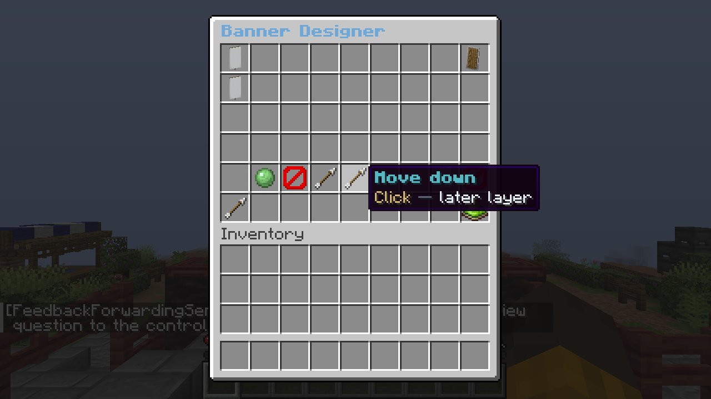
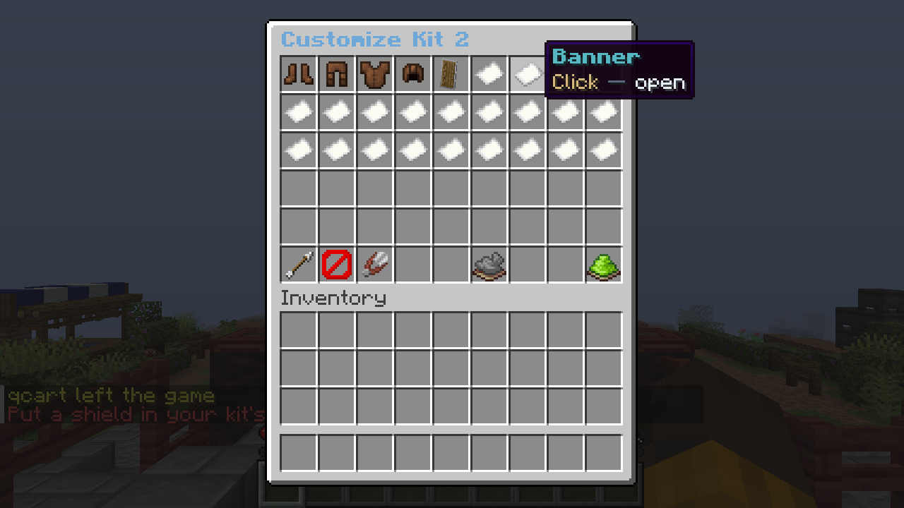
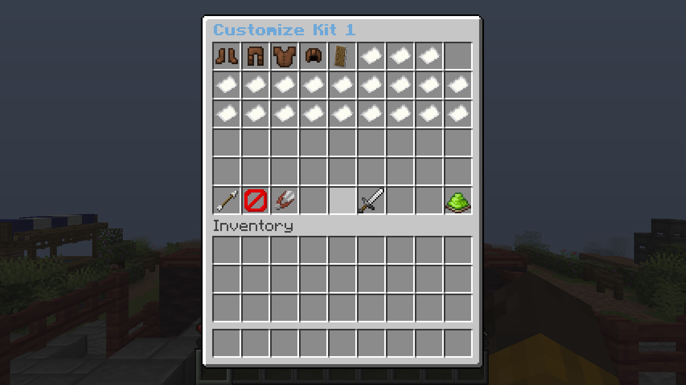
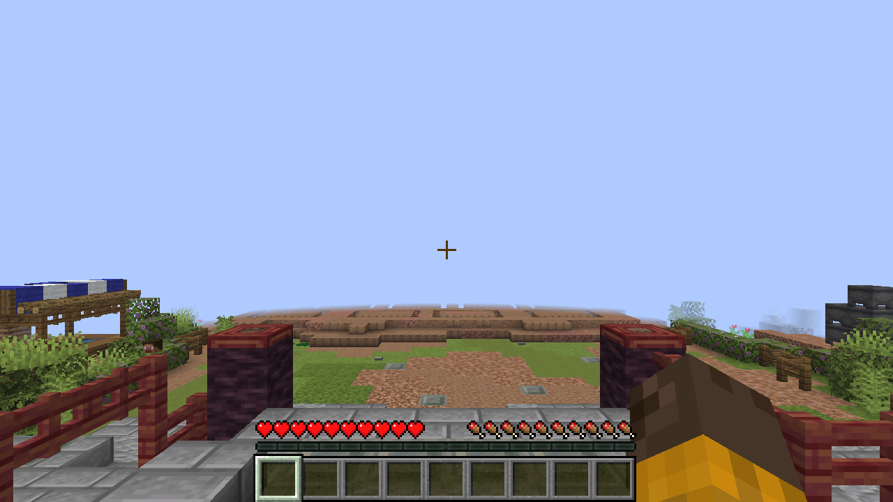

# Report: kit cosmetics follow-up defects after PR #28

- Date: 2026-11-25
- Branch/HEAD at review: `docs/test-env-proof-notes` / `55b80b7`
- Source reports: `codereview-docs-test-env-proof-notes.md`, `.scratch/kit-cosmetics-qa-report.md`, `.scratch/kit-cosmetics-review-summary.md`
- Status: **PR #28 merged; follow-up fixes not applied by this report**

## Summary

Independent review and live AgentView QA found five actionable defects in the kit cosmetics GUI. The staged-write design itself had no confirmed data-loss defect, but banner GUI integrity, layer reachability, normal-banner base dye, stale-session revival, and failed-save feedback need correction.

## Visual evidence

Customize screen with styled title, target tabs, trim picker, and footer controls:

Banner Designer with ghost template, preview shield, base/action row, and layer controls:

Banner error state observed during live guard testing:

Rename picker flow:

Rename chat prompt:

All five screenshots were captured on `client-1` / AgentView with Craftwire `screenshot` (`maxSize:1024`). During the live QA run, final ERROR logs were `[]` and exceptions `total=0`; some defects were reproduced despite no server exception.

## Defects requiring follow-up

### 1. Banner designer read-only guard is overwritten — reproduced live

`GuiScreen.java:160,168` installs `protect()` before `configure()`, but `BannerDesignerPage.java:246-259` replaces `GuiGuard`'s top-click handler and cancels only the ghost-template slot. Live QA pulled the base-colour banner, Remove-layer barrier, and Revert barrier into the cursor.

Fix direction: cancel all top clicks first, then run template-copy logic only for `BANNER_TEMPLATE_SLOT`; add a regression assertion.

### 2. Remove/Move layer controls are unreachable — reproduced live

`BannerDesignerPage.java:36` initializes `selectedLayer = -1`. Clicking a layer at `:99-105` sets it and opens `BannerPatternPickerPage`, whose Back at `:144-148` and pattern-choice return at `:120` call `BannerDesignerPage.open(..., design)` without the selected index. The reopened designer resets to `-1`, so Remove/Move at `:142-170` do nothing.

Fix direction: pass the selected layer index through the picker/designer reopen path and add a GUI test.

### 3. Normal banner base dye is dropped on ghost-template copy — reproduced live

`BannerDesign.java:47` reads base colour only from `ShieldMeta`, returning `null` for a normal banner. `BannerDesignerPage.java:249-255` uses that result for a shield design, so a red normal banner copies patterns but leaves the shield base white.

Fix direction: derive the base from the normal banner material and add a `BannerDesign.from(Material.RED_BANNER)` test.

### 4. Reload-invalidated session can be revived through Rename — code-level finding

`KitsLifecycle.java:212-213` marks sessions stale; `GUI.java:126-131` clears the stale marker in `setPendingCustomize`; `RenameTargetPage.java:85` passes the stale session back. Apply can then pass stale checks and write, bypassing spec decision 15.

Fix direction: do not clear stale state in `setPendingCustomize`; clear only on a genuine fresh `CustomizePage.open()`. Also refuse Rename/Banner entry when stale.

### 5. Failed save leaves retry dead end and false feedback — code-level finding

`KitManager.java:240-241` updates the cache before `store.saveKitToDB` resolves. On DB failure, `CustomizePage.java:297-299` reopens with the original snapshot, so `matchesCurrent` fails forever. `messages.yml:197` says "No changes were applied" although the cache changed.

Fix direction: rebuild the retained session from the live cached kit on failure and correct the message, or defer the cache mutation until the write succeeds.

## Minor / beneficial changes

- Add a direct MockBukkit test for `KitManager.savePersonalKitAsync`; current coverage stubs the `KitSaver` seam.
- Map `INVALID_CONTENT` away from the name-invalid message (`CustomizePage.java:311`, `CustomizeService.java:121-126`, `messages.yml:193`).
- Add runtime layout checks for rename and banner screens (`GuiLayoutChecks.java:32-46`).

## Not tested

Reload invalidation live; forced DB write failure; rename timeout; unavailable banner layer fail-closed live; hard maximum 16 layers; shift-click/drag into designer slots; 1.21.11 runtime; non-banner ghost-template placement. No pass is claimed for these paths.

## Verification already performed

- Fresh `./gradlew check` exited 0 during review, with `:test` and `:compileJava` reported `UP-TO-DATE`.
- Live Craftwire checks used `list_instances`, `server_info`, `logs`, `exceptions`, `gui_read`, `gui_action`, `screenshot`, `hud_read`, `chat`, and `server_eval`.
- Live QA passed for core trim/rename staging, styled titles, named registry entries, queued-to-applied feedback, empty-shield/empty-kit guards, and one-click Back discard.

## Resolution after the kit editor UX redesign (2026-11-26)

This report is retained as a historical record of the PR #28 review. The kit editor UX redesign on `feat/kit-editor-ux-redesign` supersedes the banner-designer findings:

- Defects 1–3 (read-only guard overwritten, unreachable layer controls, normal-banner base dye dropped) are obsolete rather than fixed in place: `BannerDesignerPage`, `BannerPatternPickerPage` and `BannerDesign` were deleted with the oversized customize flow. Reintroduction is deferred and tracked in [issue #35](https://github.com/kub0san/pvp-core/issues/35).
- Banner GUI, config keys (`customize.max-layers`, `customize.allowed-banner-patterns`) and banner messages/title keys were removed. Existing configs are cleaned automatically by `ConfigUpdater`.
- Shield banner layers on saved items remain opaque and survive editor save/copy/load (`ShieldMetadataPreservationTest`). Defects 4–5 are not re-verified or claimed resolved by this change; see `docs/kit-cosmetics.md` for the current item-centric flow.
