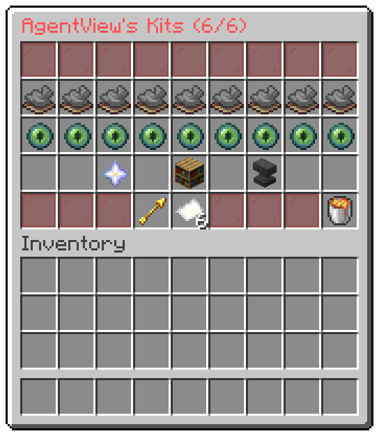

# Report: kit dashboard caps at 54 slots while config allows 99

- Date: 2026-11-25
- Branch/HEAD at investigation: `docs/test-env-proof-notes` / `55b80b7`
- Reported by: qcart, in-game ids `554b829f8d68fdefc0230464a1743f8be3429787` and `5763b7c3a8e75be760691c44891c56c2a807d93b`
- Status: **investigated; no fix applied**

## Report text

> Alright, so have the agentview review a different issue entirely, currently the max per player amonut kit is set to 54. even fi i have it set to 99 or a different issue, i want you to file a report and investigate, then propose ideas.

Clarification:

> I didnt set the 54 cap anyone, it goes kits per gui, but i nthe command it goes al lthe way till k99

## Visual evidence

AgentView on `AgentView's Kits (6/6)` shows kit/EC cards up to `54`:

Original capture: `kit-amount-cap-gui.png`, 21,376 bytes, written 2026-11-25 15:17:54 local. Server ERROR lines `[]`; exceptions `0`.

## Root cause

The cap is GUI-only. `KitListPage` reads `kits.max-slots`, then hard-clamps it to `54` in two places:

- `src/main/java/org/pvpcore/gui/kits/page/KitListPage.java:63-66` clamps the pager input with `Math.min(54, maxKits)`.
- `src/main/java/org/pvpcore/gui/kits/page/KitListPage.java:76-84` repeats `Math.max(1, Math.min(54, config.getInt("kits.max-slots", 9)))` when rendering cards.

The literal likely came from `GuiLayouts.MENU_SIZE = 54` (`src/main/java/org/pvpcore/gui/base/GuiLayouts.java:34`), the 6-row chest size, but the dashboard shows only 9 cards per page (`GuiLayouts.DASH_SLOTS_PER_PAGE = 9` at `:133`), so 54 clamped slots become 6 pages of 9.

Config, commands, parsing and storage still allow 1..99:

- Bundled default: `src/main/resources/kits/config.yml:48` `max-slots: 99`.
- Live test server: `plugins/pvp-core/kits/config.yml:47` also `99`.
- `src/main/java/org/pvpcore/util/kits/KitSlots.java:33,43-50,80-89`: `MAX_LIMIT = 99`, config clamped to 1..99, slot suffix parser accepts `k1`..`k99`.
- `src/main/java/org/pvpcore/gui/base/GuiSettingsSchema.java:124`: settings bounds 1..99.

## Live reproduction

- `/kit` opened `AgentView's Kits (1/6)` in a `generic_9x5` screen.
- Pages 1-6 contained cards `1-9`, `10-18`, `19-27`, `28-36`, `37-45`, and `46-54`; each page had exactly 9 kit cards and 9 ender-chest cards.
- Pager controls: slot 39 Previous (absent on page 1), slot 40 `Page N of 6`, slot 41 Next (absent on page 6), slot 44 Clear Inventory (shift-click).
- No page shows a label explaining the 54 limit; the last visible card is simply `54`.
- Settings was not reachable for AgentView because it is permission-gated; `/kit settings` returned "You do not have permission to do that."

## Impact

- Slots 55-99 are addressable by command and storage but never appear on the dashboard.
- Config and settings advertise 99 while the GUI shows only 54.
- The clamp is applied to both pager construction and rendering, so manual navigation past page 6 is impossible.

## Ruled out

- `GuiPager.java:26-35` only clamps page numbers; it has no 54 constant.
- `GuiTheme.java:185` caps the page-indicator stack amount, not slot count.
- `KitsCommands.java:278-279` affects command suggestions only.
- Kit-room pages use a separate 99 page-count bound.
- No unit test asserts the 54/99 dashboard cap.

## Proposed ideas (not applied)

1. **Recommended:** remove both `Math.min(54, ...)` calls and let the configured value drive the pager/renderer; this yields 11 pages of 9 cards for `max-slots: 99`. Add focused page-math tests.
2. Keep 54 and add a visible "showing first 54 of N" label plus slot jump/search.
3. Split `dashboard-max-slots` from saved-slot max with a documented config migration.

The smallest direct fix is idea 1 if the intent is for the GUI to match commands and config. Do not implement until that intent is confirmed, because ideas 2 and 3 assume 54 is deliberate.

## Disproof criteria

The finding would be wrong if the deployed jar lacked the two clamps, bundled/live config were 54, another layer independently enforced 54, or commands/storage could not address slots 55-99. None were observed.
