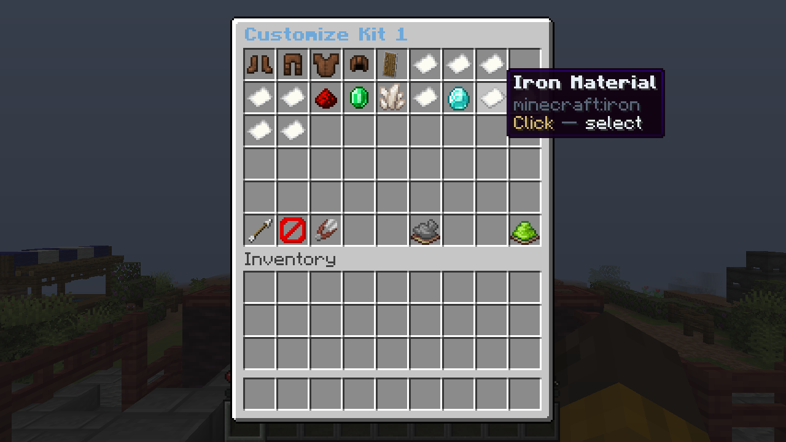
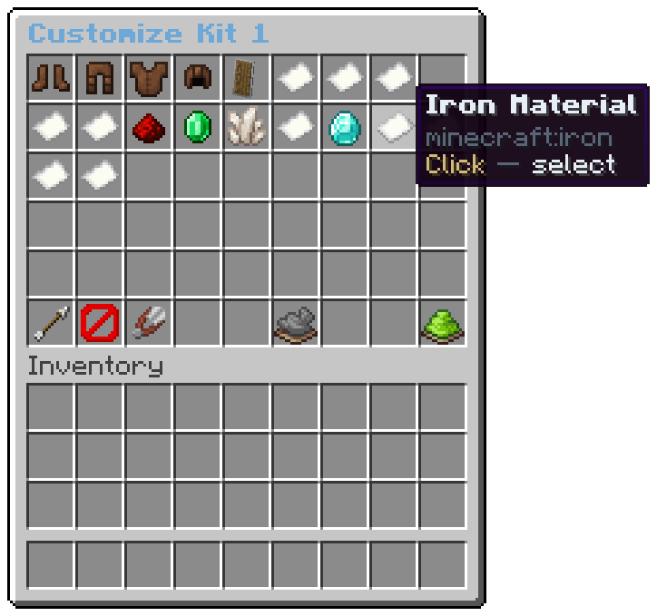

# Report: trim-material icons render as paper

- Date: 2026-11-25
- Branch/HEAD: `docs/test-env-proof-notes` / `55b80b7e64018c6011d82413d48acc5a28a94501`
- Reported by: qcart, in-game id `2f3464dfdcab7a359efc144cc27d189216b990a9`
- Report text: "Alright some of the material names are wrong, like minecraft:iron, this shows a paper item isnteado f iron ingot."
- Status: **reproduced; root cause identified; no fix applied**

## Executive summary

The armour-trim material picker does not use the trim registry material's ingredient item. It converts the registry path directly into a Bukkit `Material` name, so `minecraft:iron` becomes `Material.matchMaterial("minecraft:iron")`. Bukkit has `IRON_INGOT`, not `IRON`, so the lookup fails and the icon factory falls back to `Material.PAPER`. This affects 7 of the 11 vanilla trim materials. The same icon-factory pattern also makes all trim-pattern entries render as paper because it searches non-existent `*_smithing_template` / `*_smithery_template` names.

Selection and Apply are not affected: the GUI stores the registry key and resolves it back through the Paper registry.

## Visual evidence

Full picker, with the hovered tooltip `Iron Material / minecraft:iron / Click — select`:

Zoomed GUI+tooltip layer at `guiScale:3`:

Original captures were made with Craftwire `screenshot` on `client-1` / AgentView:

- `kit-material-icon-bug-picker.png` — 220,486 bytes, written 2026-11-25 16:22:36 local
- `kit-material-icon-bug-iron-zoom.png` — 25,092 bytes, written 2026-11-25 16:22:58 local

## Live reproduction

Screen path: `Kit: 1` → slot 41 `Customize` → `Trim` tab → select a pattern → material picker.

`gui_read` on the material picker showed:

| Slot | Name | Lore key | Item type shown |
|---:|---|---|---|
| 9 | Netherite Material | `minecraft:netherite` | `minecraft:paper` |
| 10 | Gold Material | `minecraft:gold` | `minecraft:paper` |
| 11 | Redstone Material | `minecraft:redstone` | `minecraft:redstone` |
| 12 | Emerald Material | `minecraft:emerald` | `minecraft:emerald` |
| 13 | Quartz Material | `minecraft:quartz` | `minecraft:quartz` |
| 14 | Resin Material | `minecraft:resin` | `minecraft:paper` |
| 15 | Diamond Material | `minecraft:diamond` | `minecraft:diamond` |
| 16 | **Iron Material** | **`minecraft:iron`** | **`minecraft:paper`** |
| 17 | Lapis Material | `minecraft:lapis` | `minecraft:paper` |
| 18 | Amethyst Material | `minecraft:amethyst` | `minecraft:paper` |
| 19 | Copper Material | `minecraft:copper` | `minecraft:paper` |

The pattern catalog immediately before the material step also showed all 18 trim patterns as `minecraft:paper`, with correct lore keys such as `minecraft:rib` and `minecraft:vex`.

Live health checks: server `ERROR` lines `[]`; no new exceptions during reproduction. Three pre-existing AgentView client exceptions were present before and after (offline auth, Realms, resource-pack glyph grid) and are unrelated to this GUI path.

## Root cause

### Data flow

1. `CosmeticCatalog.fromRegistries(rules)` builds entries from `RegistryKey.TRIM_MATERIAL` (`src/main/java/org/pvpcore/features/kits/cosmetics/CosmeticCatalog.java:55-64`).
2. `entries()` converts `value.getKey()` to the registry key string, e.g. `minecraft:iron`, and applies the icon factory (`CosmeticCatalog.java:82-98`).
3. `materialIcon()` calls `item(key.getNamespace(), key.getKey())` (`CosmeticCatalog.java:155-158`).
4. `item()` calls `Material.matchMaterial(namespace + ":" + path)` and returns `null` unless the result is a real item material (`CosmeticCatalog.java:160-167`).
5. `materialIcon()` substitutes `Material.PAPER` whenever the lookup fails (`CosmeticCatalog.java:157`).
6. `CustomizePage` rebuilds the display icon from `entry.icon().getType()` and prints the raw key in dim lore (`src/main/java/org/pvpcore/gui/kits/editor/CustomizePage.java:137-141`).

The exact failing lookup is therefore `Material.matchMaterial("minecraft:iron")`, which returns `null` because Bukkit's enum constant is `IRON_INGOT`.

### Why only some materials are wrong

The registry path is not a Bukkit material name. These vanilla paths do not match a `Material` constant:

| Registry path | Required Bukkit item |
|---|---|
| `minecraft:iron` | `IRON_INGOT` |
| `minecraft:gold` | `GOLD_INGOT` |
| `minecraft:copper` | `COPPER_INGOT` |
| `minecraft:netherite` | `NETHERITE_INGOT` |
| `minecraft:lapis` | `LAPIS_LAZULI` |
| `minecraft:amethyst` | `AMETHYST_SHARD` |
| `minecraft:resin` | no direct `RESIN` material |

`minecraft:diamond`, `minecraft:emerald`, `minecraft:quartz`, and `minecraft:redstone` happen to match `Material` names, which matches the live observation that only those four show real icons.

### Related pattern-icon defect

`templateIcon()` looks for `<path>_smithing_template` and `<path>_smithery_template` (`CosmeticCatalog.java:149-153`). Bukkit uses names such as `COAST_ARMOR_TRIM_SMITHING_TEMPLATE`; the attempted names do not exist, so pattern entries also fall back to PAPER. This is the same root design error—treating a registry path as if it were a Bukkit material name—applied to trim patterns.

### Not the cause

- Registry selection/apply is correct: `CustomizePage.resolveTrimChoice` resolves the stored key through `RegistryKey.TRIM_MATERIAL` (`CustomizePage.java:104-118`), and `CosmeticApplier.applyTrim` uses the resolved `TrimMaterial` object (`src/main/java/org/pvpcore/features/kits/cosmetics/CosmeticApplier.java:28-44,90-98`).
- Config allowlists use registry keys and do not convert them to materials (`src/main/java/org/pvpcore/config/kits/CustomizeRules.java:101-131`).
- The `IRON Material` label comes from `describedLabel`/`humanReadable` and correctly renders `minecraft:iron` as `Iron` (`CosmeticCatalog.java:114-147`). The displayed raw key in lore is evidence of the registry identity, not the icon-failure source.

## History

- `8a52311` `feat: add cosmetic registry catalog` introduced `materialIcon`, `templateIcon`, and `item()` on 2026-11-25. No later commit changed `CosmeticCatalog.java`.
- `273b441` introduced the trim picker.
- `55b80b7` changed the picker to rebuild icons from `entry.icon().getType()` and display the raw key; this made the wrong type visible but did not create the bad mapping.

## Hypotheses tested

1. **Confirmed:** raw registry path is passed directly to `Material.matchMaterial`, causing PAPER fallback for unmapped paths. Evidence: `CosmeticCatalog.java:155-167` plus live slot 16 `minecraft:iron` → `minecraft:paper`.
2. **Confirmed as related:** pattern icons use non-existent template suffixes. Evidence: `CosmeticCatalog.java:149-153` plus all 18 pattern entries showing PAPER in live `gui_read`.
3. **Rejected as root cause:** config allowlist rewriting. Evidence: GUI lore key is exactly `minecraft:iron`, matching the registry key; `CustomizeRules.java:101-131` only normalizes allowlist comparison strings.
4. **Rejected as root cause:** rendering rebuild in `CustomizePage`. Evidence: it uses `entry.icon().getType()` (`CustomizePage.java:140`); the type was already PAPER from `CosmeticCatalog`.

## Proposed fix options (not applied)

1. **Minimal and recommended:** add an explicit trim-registry-path → Bukkit item mapping in `CosmeticCatalog.materialIcon`, covering at least `iron`, `gold`, `copper`, `netherite`, `lapis`, `amethyst`, and `resin`; keep the existing `matchMaterial` path for entries whose registry path already matches a material. Add a package-private seam and unit tests that assert `minecraft:iron` resolves to `IRON_INGOT` and previously working keys remain unchanged.
2. **Pattern fix in the same change:** map trim-pattern keys to `<path>_ARMOR_TRIM_SMITHING_TEMPLATE` where available, with a data-pack-safe fallback that does not pretend an unknown template has a vanilla item icon.
3. **Alternative:** store/display an explicit icon key in config per cosmetic entry. This is more flexible but adds schema and admin burden; not warranted for vanilla registry cosmetics.

## Regression test plan

- At the `CosmeticCatalog` icon seam, assert:
  - `minecraft:iron` → `IRON_INGOT`
  - `minecraft:gold` → `GOLD_INGOT`
  - `minecraft:copper` → `COPPER_INGOT`
  - `minecraft:netherite` → `NETHERITE_INGOT`
  - `minecraft:lapis` → `LAPIS_LAZULI`
  - `minecraft:amethyst` → `AMETHYST_SHARD`
  - `minecraft:diamond` remains `DIAMOND`
- Re-run AgentView: `Kit: 1` → `Customize` → `Trim` → pattern → material picker; assert slot 16 item is `minecraft:iron_ingot` and that the four previously correct materials are unchanged.
- Run `./gradlew check`.

## Scope and limitations

- No plugin source, config, test, deploy, restart, or saved-data changes were made for this investigation.
- The AgentView QA report is at `.scratch/material-icon-bug-repro.md` (local-only scratch). This tracked report embeds the two required screenshots under `docs/reports/evidence/`.
- The main controller session could not display PNG input directly; the screenshots were captured and visually inspected by the QA subagent, then copied and verified on disk for this report.
